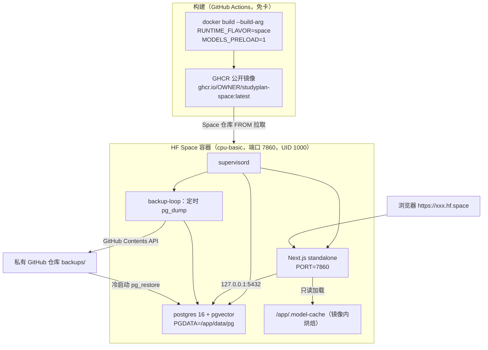

# 免银行卡免费托管选型与部署手册（HF Spaces 单容器）

> 适用约束：**全程无银行卡** + **可休眠/冷启动** + **Postgres/pgvector 必须同机** + **CPU ONNX 嵌入/重排模型**（Qwen3-Embedding / Qwen3-Reranker 0.6B q8，运行期约 1.5–2GB 内存）。
> 数据核实时间：2026-10。

## 1. 结论先行

**首选：Hugging Face Spaces（Docker SDK，cpu-basic 免费档）**，把 Postgres/pgvector 与 Next.js 放进**同一个容器**运行；
镜像由 **GitHub Actions 免费额度构建并推送到 GHCR（公开包）**，Space 仓库只放 2 行 `Dockerfile`（`FROM ghcr.io/...`）+ README，**绕开 Space 仓库内构建**。

- 免卡：HF 邮箱注册、GitHub Actions、GHCR 公开包，三者**均不要求任何银行卡**。
- 规格：cpu-basic = 2 vCPU / 16GB RAM / 50GB 存储，远超 1.5–2GB 的模型内存需求。
- 休眠：48 小时无访问自动休眠，HTTP 请求可唤醒（用户已接受）。
- 同机 pgvector：PG 作为容器内的第二个进程（supervisord 托管），满足"同机"红线。

## 2. 候选对比

| 方案 | 银行卡 | 规格 | 休眠策略 | 同机 pgvector | 结论 |
| --- | --- | --- | --- | --- | --- |
| **HF Spaces（Docker SDK）+ GHCR 预构建镜像** | 全程免卡 | 2 vCPU / 16GB / 50GB | 48h 无访问休眠，可唤醒 | ✅ 同容器多进程 | **首选** |
| Cloudflare Tunnel + 自持主机（Windows/WSL2、旧电脑） | 免卡 | 取决于机器 | 不休眠（需机器常开） | ✅ 现有 compose 直接跑 | **备选 A**：零改造，但要有常开机器 |
| GitHub Codespaces 免费额度 | 免卡（GitHub 账号） | 4 核 / 16GB，支持 Docker-in-Docker | 停即停，受机时额度 | ✅ 可跑 compose | **备选 B**：仅临时验证，30 天不活动回收 |
| Render / Koyeb / Zeabur 免费档 | 免卡 | **512MB 内存** | 15min 休眠 | ❌ 不支持同机 PG | **排除**：内存装不下 ONNX 权重 |
| Oracle Always Free / DO / Vultr / Linode / Azure / GCP | **需卡（含预授权）** | 4C/24G 等 | 不休眠 | ✅ | **排除**：违反免卡红线 |
| ClawCloud Run | 免卡 | $5/月 | — | — | **排除**：2026 已停服 |

### 为什么"免卡 + 真 VPS + docker compose"几乎没有正规选项

2026 年核实结果：真正免信用卡的独立 VPS 只剩 Oracle Always Free（**多数地区仍需信用卡验证**，已被红线排除）；
社区分享型 FreeVPS（测试账号）稳定性与合规性差，不适合承载数据库。
因此在"可休眠"这个已被接受的让步下，唯一的规模化可行解是 **免费 PaaS 中内存最大的 HF Spaces**，并接受"PG 塞进同一容器"这一形态。

## 3. 架构



### 关键决策与代价

1. **权重烘焙进镜像（`MODELS_PRELOAD=1`）**：容器文件系统临时，冷启动现拉 1.2GB 权重会让唤醒慢到分钟级；烘焙后镜像约 2.5–3GB，构建变慢是代价，换来秒级加载 + 运行期 `LOCAL_MODELS_ONLY=1` 完全离线。
2. **runner 基础镜像换 `pgvector/pgvector:pg16`（Debian）**：Alpine 上 pgvector 需自编译且版本易错配；官方镜像自带扩展，只需再装 Node tarball + supervisor。standalone flavor 仍用 `node:24-alpine`，两种产物互不影响。
3. **supervisord 托管 postgres / next / backup**：都要自动重启、日志分流到 stdout；统一以 **UID 1000 / 用户 `nextjs`** 运行（Space 要求非 root，PG 亦拒绝 root 启动）。
4. **预构建镜像而非仓库内构建**：规避 Space 构建超时与源码上传，也让"权重烘焙 + 大镜像"完全可控，回滚退化为切 tag/digest。
5. **备份落地用 GitHub 私有仓库**：Contents API 语义稳定（PUT 需 `sha`、GET 用 `application/vnd.github.raw` 可绕过 1MB 限制），fine-grained PAT 只需 contents 读写权限，免费且免卡。
6. **向后兼容**：新增 `ARG RUNTIME_FLAVOR=standalone`（默认），`docker compose build app` 的行为**逐字节不变**，本地链路零回归；Space flavor 的全部新增物集中在 `docker/space/`。

## 4. 运行期行为

### 冷启动顺序（每次唤醒都会重跑，文件系统是新的）

1. `entrypoint-space.sh`：`id -u=0` 时用 `setpriv` 降到 UID 1000；
2. `postgres-run.sh`：`PGDATA` 为空则 `initdb` → 建库 `studyplan` → `CREATE EXTENSION vector` → 前台起 PG；
3. `start-next.sh`：`pg_isready` 轮询（默认最多 120s）→ `db-restore.mjs`（拉 `backups/latest.dump` 恢复，**无备份则跳过**）→ `check-env.mjs` → `migrate.mjs` → `exec node server.js`；
4. `backup-loop.sh`：每 `BACKUP_INTERVAL_MIN`（默认 30）分钟 `pg_dump` 上传。

任一步失败非零退出，日志直接进入 Space 的 container logs，便于定位。

### 持久化闭环（免费档无持久卷，必须自建）

- 备份：`pg_dump --format=custom --compress=9` → GitHub 私有仓库 `backups/latest.dump` + `backups/<UTC 时间戳>.dump`。
- 恢复：冷启动拉 `latest.dump` → `pg_restore --clean --if-exists`。
- 保留：`BACKUP_KEEP`（默认 24）份历史滚动清理。
- 失败策略：备份/恢复失败**只告警不阻断启动**（应用降级可用，见 `lib/health.ts` 的 `database=disconnected` → 503）；需要严格失败时设 `BACKUP_STRICT=1`。
- 局限：最坏情况丢失最近一个备份周期内的数据。重要数据请把 `BACKUP_INTERVAL_MIN` 调到 5 分钟级别（dump 体积通常只有几 MB，上传很快）。

## 5. 部署步骤

### 5.1 准备（全部免卡）

1. HF 账号（邮箱注册）→ 新建 **Space**：SDK = **Docker**，硬件 = **CPU basic（free）**。
2. GitHub 上新建**私有仓库**用于存放备份（如 `studyplan-backups`），建一个 fine-grained PAT（仅 `Contents: Read and write`，限定该仓库）→ `BACKUP_GITHUB_TOKEN`。
3. 生成 `BETTER_AUTH_SECRET`（≥32 位随机串）：`node -e "console.log(require('crypto').randomBytes(32).toString('base64'))"`。
4. GHCR 无需额外 Secrets：工作流用自带的 `GITHUB_TOKEN`（`packages: write`）推送。

### 5.2 镜像构建与推送

```bash
# 本地构建（需 Docker）：MODELS_PRELOAD=1 会下载约 1.2GB 权重，耗时较长
# ⚠ 烘焙权重必须配 BUILDER_IMAGE 为 glibc 镜像：onnxruntime-node 只有 glibc 二进制，
#   在 alpine(musl) 上 pnpm models:download 会 ERR_DLOPEN_FAILED（ld-linux-x86-64.so.2）。
docker build --build-arg RUNTIME_FLAVOR=space \
  --build-arg MODELS_PRELOAD=1 \
  --build-arg BUILDER_IMAGE=node:24-slim \
  --build-arg NEXT_PUBLIC_SITE_URL=https://<user>-<space>.hf.space \
  -t ghcr.io/<owner>/studyplan-space:latest .

docker push ghcr.io/<owner>/studyplan-space:latest   # 需先把包设为 public（Packages → Package settings → visibility）
```

或交给 CI：推送 `v*` tag 即触发 `.github/workflows/space-image.yml` 构建并推送 GHCR。

> 受限网络（Docker Hub 不可达）时，可用 `--build-arg BUILDER_IMAGE=node:24-slim` 把 builder 阶段
> 换成本机/私有源已有的等价 Node 镜像；运行阶段不依赖 Docker Hub 之外的私有镜像。

> `HF_ENDPOINT` 默认 `https://hf-mirror.com`；境外构建机若镜像不可达，可用仓库变量 `vars.HF_ENDPOINT` 置空直连官方源。

### 5.3 Space 仓库内容（只有两个文件）

`Dockerfile`：

```dockerfile
FROM ghcr.io/<owner>/studyplan-space:latest
```

`README.md`（模板见 `docker/space/README-space.md`）：

```markdown
---
title: StudyPlan
emoji: 📚
colorFrom: blue
colorTo: indigo
sdk: docker
app_port: 7860
pinned: false
---
```

### 5.4 Space 的 Secrets（Settings → Repository secrets）

| Secret | 必填 | 说明 |
| --- | --- | --- |
| `BETTER_AUTH_SECRET` | ✅ | ≥32 位随机串，生产 fail-fast 要求（`NODE_ENV=production`） |
| `BETTER_AUTH_URL` | ✅ | `https://<user>-<space>.hf.space`，必须 `https://` 开头，否则 `check-env.mjs` 退出 1 |
| `BACKUP_GITHUB_REPO` | ✅ | `owner/repo`，存放 dump 的私有仓库 |
| `BACKUP_GITHUB_TOKEN` | ✅ | fine-grained PAT（contents 读写） |
| `BACKUP_INTERVAL_MIN` | ➖ | 备份间隔分钟，默认 30 |
| `BACKUP_KEEP` | ➖ | 保留历史份数，默认 24 |
| `AI_API_KEY` / `AI_BASE_URL` / `AI_MODEL` | ➖ | 未配则 AI 能力降级 |
| `AI_EMBED_MODEL` / `AI_RERANK_MODEL` | ➖ | 未配则 ⌘K 语义检索分组不显示（仅页面导航） |
| `TAVILY_API_KEY` | ➖ | 未配则不注册搜索 tool |
| `GITHUB_TOKEN` | ➖ | `/trending` 每日热门数据；未配则页面显示配置提示空态（fine-grained PAT 即可） |
| `GITHUB_TRENDING_PER_PAGE` | ➖ | 每日抓取条数，默认 30 |
| `RAG_FALLBACK_SCORE` | ➖ | RAG 质量闸门阈值，默认 0.35（低于则转网搜兜底） |

其余（`DATABASE_URL`、`PORT=7860`、`PGDATA`、`LOCAL_MODELS_ONLY=1`、`MODEL_CACHE_DIR`）已烘焙进镜像，无需注入。

### 5.5 触发部署

推送 Space 仓库 → HF 拉取 GHCR 镜像 → 访问 `https://<user>-<space>.hf.space` 唤醒。

## 6. 验证清单

```bash
# ① 健康接口（200 且 database=connected）
curl -s https://<space>/api/health

# ② 同机 pgvector 生效
psql -U studyplan -d studyplan -c "SELECT extname FROM pg_extension WHERE extname='vector';"

# ③ 离线权重加载：走一次「提问 → 嵌入 → 检索 → 重排」，确认无 ModelLoadError

# ④ 备份/恢复演练：等待一轮备份 → 在 GitHub 备份仓库确认 latest.dump 更新 → Space Restart → 数据仍在

# ⑤ 休眠策略：连续 48h 无访问后首次请求能唤醒，健康检查转 200
```

本地等价验证（不依赖 Space，一键）：

```bash
pnpm verify:space                      # = sh scripts/verify-space.sh：构建 → 运行 → 冒烟 → pgvector 断言 → 清理
MODELS_PRELOAD=1 pnpm verify:space     # 一并把 1.2GB 权重烘焙进去，验证离线加载
KEEP=1 pnpm verify:space               # 失败时保留容器排查
```

脚本内部依次做：构建 space 形态镜像 → `docker run -p 7860:7860` → `APP_PORT=7860 node scripts/smoke-container.mjs`
（`/api/health`、`/`、`/ebook`、`/ai`）→ `psql` 断言 `pg_extension.vector` 存在 → 打印日志尾部并清理容器。

## 6.1 已完成的本地验证（2026-10-11，Docker 29.8.2）

构建命令：

```bash
docker build --build-arg RUNTIME_FLAVOR=space --build-arg MODELS_PRELOAD=1 \
  --build-arg BUILDER_IMAGE=node:24-slim \
  --build-arg NEXT_PUBLIC_SITE_URL=https://studyplan.hf.space -t studyplan:space .
```

| 项 | 结果 | 证据 |
| --- | --- | --- |
| 镜像构建（含 1.8GB 权重烘焙） | ✅ | `studyplan:space` 2.79GB |
| 冷启动链路（initdb → 建库 → PG 监听 → restore 跳过 → check-env → migrate → Next） | ✅ | 日志：`database system is ready` → `[migrate] 迁移完成` → `Ready`，`drizzle.__drizzle_migrations` 4 条 |
| 端点冒烟（7860） | ✅ | `[smoke] health=ok/connected home=200 ebook=200 ai=200 @ http://localhost:7860` |
| 同机 pgvector | ✅ | `SELECT extname FROM pg_extension WHERE extname='vector'` → `vector` |
| 嵌入模型离线加载 | ✅ | `[onnx] embed OK dims=1x1024 ms=2694`（与 `vector(1024)` 对齐） |
| 重排模型离线加载 | ✅ | `[onnx] rerank OK yesId=9693 ms=6057` |
| 备份降级（未配 `BACKUP_GITHUB_REPO`） | ✅ | `[restore] FAIL: BACKUP_GITHUB_REPO 未配置` → 按空库继续，服务照常 200 |
| 默认 standalone 形态零回归 | ✅ | `docker build -t studyplan:standalone .` → 1.31GB，默认 alpine、无权重，行为不变 |

### 过程中修掉的 4 个真问题（均在两种形态上同时存在）

1. `onnxruntime-node` 只发布 glibc 二进制 → alpine(musl) builder 跑 `models:download` 报 `ERR_DLOPEN_FAILED`。
   处理：`MODELS_PRELOAD=1` 必须配 `--build-arg BUILDER_IMAGE=node:24-slim`（`verify-space.sh` 已自动切换）。
2. `NEXT_PUBLIC_SITE_URL` 为空串时 `new URL('')` 抛 `ERR_INVALID_URL`，`next build` 直接失败。
   处理：`app/layout.tsx`、`app/sitemap.ts`、`app/robots.ts` 改用 `||` 兜底，Dockerfile 的 ARG 默认值改为合法 URL。
3. Next standalone 的 file tracing **不带** `drizzle-orm` → `scripts/migrate.mjs` 报 `Cannot find package 'drizzle-orm'`。
4. 同理不带 `onnxruntime-node` / `onnxruntime-common` → 运行期嵌入与重排直接 `Cannot find module`。
   处理：3、4 均在 builder 阶段用 `cp -rL` 从 `.pnpm` 解引用复制，装配阶段放进 `/app/node_modules`。

## 7. 回滚

- Space 侧：Space 仓库回退到上一 commit，或把 `FROM` 固定到旧 tag/digest（推荐：`@sha256:...`）。
- 数据侧：从 GitHub 备份仓库下载历史 dump → 本地 `pg_restore` 校验 → 覆盖 `latest.dump` 后重启 Space。
- 本地链路始终可用（`docker compose up -d` 行为未变），作为兜底回滚路径。

## 8. 已知风险

| 风险 | 影响 | 缓解 |
| --- | --- | --- |
| 免费档无持久卷，容器 FS 临时 | 数据依赖备份闭环 | 缩短 `BACKUP_INTERVAL_MIN`；重要操作后等待下一轮备份 |
| 48h 休眠 + 冷启动要 initdb + 恢复 | 首次请求可能数十秒 | 权重烘焙进镜像（省去 1.2GB 下载）；可接受则忽略 |
| 备份窗口内数据丢失 | 最坏丢一个间隔的数据 | 调到 5 分钟级；dump 小、上传快 |
| 镜像约 3GB | GHCR 拉取/存储耗时 | 公开包无限额度；必要时只烘焙 embedding 权重 |
| `NEXT_PUBLIC_SITE_URL` 是 build 期内联 | sitemap/robots 元数据 | 构建时以 build-arg 传入真实 Space 域名 |
| 2 vCPU 下 ONNX 为 CPU 密集 | 并发高时延迟上升 | `AI_DAILY_LIMIT` 限流 + 懒加载单例（现状已是） |
| 备份 PAT 权限 | token 泄露影响备份仓库 | 用 fine-grained PAT，仅授权单个私有仓库 |

## 9. 备选路径速览

- **备选 A（Cloudflare Tunnel + 自持主机）**：本机跑现有 `docker compose`（Caddy + app + pgvector），用 `cloudflared tunnel` 免费暴露，域名用免费二级域名。**零改造、数据自持、不休眠**，代价是需要一台常开的机器。
- **备选 B（GitHub Codespaces）**：4 核 / 16GB、Docker-in-Docker 可跑完整 compose，端口设为 public 即得访问 URL；受每月免费机时限制、30 天不活动回收，适合临时验证而非长期托管。
